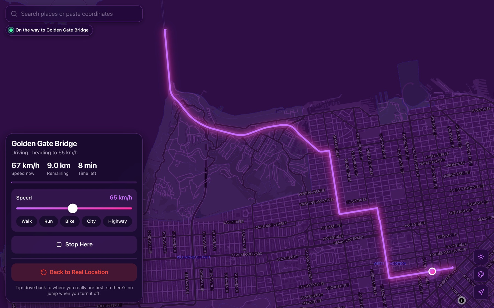
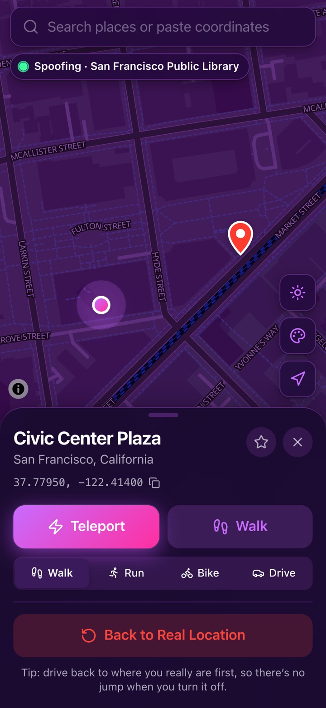
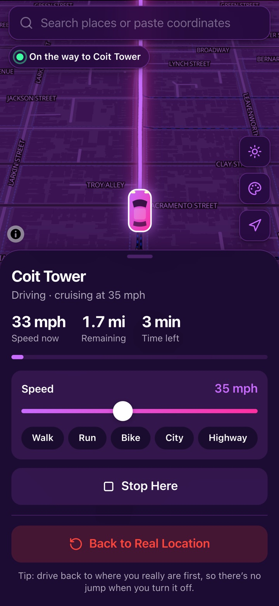
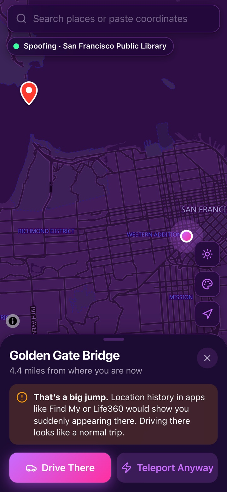
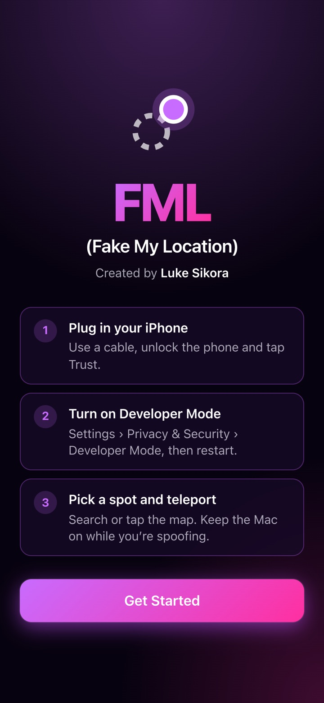
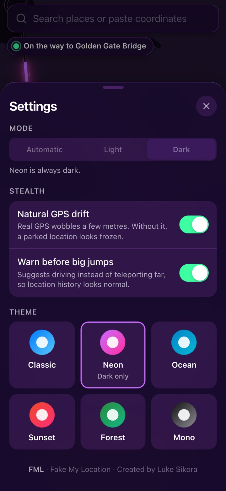

<div align="center">

# FML (Fake My Location)

### Be somewhere else. Your location says otherwise.

**Created by Luke Sikora** · Free for Mac + iPhone

**[🌐 Website](https://lukesikora.github.io/fake-my-location/)** · **[📥 Install](#-install-it-about-2-minutes)** · **[🕵️ Stealth tips](#stealth)** · **[🆘 Help](#-something-not-working)**



</div>

---

## 🤔 What is FML?

FML changes your iPhone's GPS location to anywhere you pick, so **everyone checking your location sees what you want them to see.**

- 👩 **Mom checks Find My?** She sees you at the library.
- ❤️ **Your partner checks the family app?** You're still at work.
- 📍 **Anyone checks your location?** You're wherever you say you are.

It changes the location for the **whole iPhone**, so Find My, family location apps, Snapchat, Maps and every other app see the fake spot. You can **teleport** there instantly, or **drive** there along real roads so it looks like a normal trip.

<div align="center">
<table>
<tr>
<td align="center"><br><b>Pick a spot</b><br>Search or tap the map</td>
<td align="center"><br><b>Drive there for real</b><br>Change speed while moving</td>
<td align="center"><br><b>No suspicious jumps</b><br>FML warns you first</td>
</tr>
</table>
</div>

---

## ✅ What you need

- A **Mac** (any Mac from the last few years)
- An **iPhone** on iOS 17 or newer
- A **cable** to plug your iPhone into your Mac

> FML runs on your Mac. Your iPhone stays at the fake location **as long as FML is open on your Mac**.

---

## 📥 Install it (about 2 minutes)

You only do this once.

### Step 1: Open Terminal

Terminal is an app that's already on every Mac.

1. Press **⌘ Command + Space** on your keyboard (a search bar pops up).
2. Type **Terminal**.
3. Press **Return**.

A window with text opens. That's Terminal.

### Step 2: Copy this line

Hover over the gray box below and click the **copy button** (📋) on its right side.

```
curl -fsSL https://raw.githubusercontent.com/lukesikora/fake-my-location/main/install.sh | bash
```

### Step 3: Paste it into Terminal

1. Click inside the Terminal window.
2. Press **⌘ Command + V** to paste.
3. Press **Return**.

Wait until you see **✓ FML is installed!** FML then opens by itself in a new window and in your web browser.

> 💡 **If your Mac asks** *"Do you want the application python to accept incoming network connections?"*, click **Allow**. That lets your iPhone control FML.

You'll now have an **FML** icon on your Desktop. 🎉

<div align="center"></div>

---

## 📱 Set up your iPhone (first time only)

1. **Plug your iPhone into your Mac** with the cable.
2. **Unlock your iPhone.** If it asks **"Trust This Computer?"**, tap **Trust** and type your passcode.
3. In FML on your Mac, tap anywhere on the map, then click **Teleport**.
4. If FML says **Developer Mode is off**:
   1. On your iPhone, open **Settings** → **Privacy & Security**.
   2. Scroll all the way to the bottom and tap **Developer Mode**.
      *(Don't see it? Click **Teleport** in FML once more. FML makes the switch appear. Then close and reopen Settings.)*
   3. Turn it **on** and tap **Restart**.
   4. After your iPhone restarts, unlock it, tap **Turn On**, and enter your passcode.
5. Click **Teleport** in FML again. Your iPhone is now somewhere else! 🌍

---

## 🗺️ Using FML

1. **Double-click FML on your Desktop.** (Plug in your iPhone first.)
2. **Search for a place** at the top (typos are fine, and you can paste a Google Maps link), or **tap anywhere on the map**.
3. Click **Teleport**. Done!

| Button | What it does |
|---|---|
| **Teleport** | Jumps your iPhone straight to that spot. |
| **Walk / Run / Bike / Drive** | Moves you there along real roads. (Teleport somewhere first.) |
| **Speed slider** | Shows up while you're moving. Drag it to speed up or slow down, any time. |
| **GPS view** | While moving, the map tilts and turns like turn-by-turn navigation, with a car (or an arrow when walking) pointing where you're going. Drag the map to look around and tap the arrow button to follow again. |
| **⭐ Star** | Saves the place so you can go back with one tap. |
| **🌙 / ☀️** | Switches between light and dark. |
| **🎨** | Settings: stealth options and color themes, including **Neon**. |
| **Back to Real Location** | Turns FML off and puts your iPhone back where it really is. |

> ⚠️ **Keep the FML window open** while you're using a fake location. If you close it or unplug your iPhone, your iPhone goes back to its real location.

---

<a id="stealth"></a>

## 🕵️ Don't get caught

FML is built so your location **looks real**, not fake. Here's what it does for you, and what you should do yourself.

<div align="center">
<table>
<tr>
<td align="center"><br><b>Moves like a real car</b></td>
<td align="center"><br><b>Stealth settings</b></td>
</tr>
</table>
</div>

### What FML does automatically

| | |
|---|---|
| 🚗 **Real driving** | Speeds up gradually, slows down for corners, and rolls to a stop at the end. Never a perfectly steady speed. |
| 🎚️ **Live speed** | Change your speed mid-trip with the slider, like hitting traffic or the highway. |
| 📡 **GPS drift** | When you're "parked", your dot wobbles a few metres like real GPS. A dot that never moves looks fake. |
| ⚠️ **Jump warnings** | Teleporting across town shows up as an instant jump in location history. FML warns you and offers to **drive there instead**. |
| ☕ **Keeps your Mac awake** | If your Mac sleeps, your real location comes back. FML stops that from happening. |

Turn these on or off in **🎨 → Stealth**.

### What you should do

1. **Start where you really are.** Your first teleport is a jump from your real location. Teleport somewhere close to where you are, then **drive** to where you want them to think you are.
2. **Use realistic speeds.** Walk around 3 mph, drive 25–40 mph in town. Nobody drives 80 through a neighborhood.
3. **Drive back before you turn it off.** When you're done, drive your fake location back to where you really are, *then* click **Back to Real Location**. No jump.
4. **Keep your Mac plugged in, with the lid open.** Closing the lid or unplugging the iPhone ends the fake location.
5. **Mind your battery and Wi-Fi.** Some family apps also show battery level and which Wi-Fi network you're on. FML only changes your location.

### ⚠️ Being straight with you

FML makes your movement look natural, but **nothing can guarantee you won't get caught.** iOS quietly tags locations that come from developer tools, and any app *could* check that tag. Your real location also comes back the moment FML closes, the cable comes out, or your Mac sleeps.

---

## 📲 Control it from your iPhone (optional)

When FML opens, the Terminal window shows a **QR code**.

1. Make sure your iPhone and Mac are on the **same Wi-Fi**.
2. Open the **Camera** app on your iPhone and point it at the QR code. Tap the link that pops up.
3. To make it look like an app: tap the **Share** button (□ with an arrow) → **Add to Home Screen** → **Add**.

Now you have an FML app icon on your iPhone. 🙌 *(Your Mac still has to have FML open.)*

> 🔒 That link has a secret code in it so nobody else on your Wi-Fi can move your phone. **Don't share it.**

---

## 🆘 Something not working?

| What you see | What to do |
|---|---|
| **"iPhone not found"** | Plug the iPhone in and unlock it. Still nothing? Try a **different cable**, because some cables only charge. |
| **"Look at your iPhone: tap Trust"** | Unlock your iPhone, tap **Trust**, and type your passcode. |
| **"Developer Mode is off"** | Follow step 4 in [Set up your iPhone](#-set-up-your-iphone-first-time-only). |
| **The page won't open on my iPhone** | Make sure both are on the same Wi-Fi. On your Mac, open **System Settings → Network → Firewall** and allow **python**. |
| **My location went back to normal** | FML closed, the cable came out, or the Mac lid was closed. Keep FML open and the Mac plugged in with the lid open. |
| **"command not found" or another error while installing** | Copy the install line again and paste it into Terminal. Make sure you copied the **whole** line. |
| **The FML icon on my Desktop is gone** | Run the install line again. It brings it back. |

---

## 🔄 Update FML

Paste the **same install line** into Terminal again. Your saved places are kept.

```
curl -fsSL https://raw.githubusercontent.com/lukesikora/fake-my-location/main/install.sh | bash
```

## 🗑️ Uninstall FML

Close FML, then paste this into Terminal and press **Return**:

```
rm -rf ~/FML ~/Desktop/FML.command
```

---

## ⚠️ Heads up

- Some games (like **Pokémon GO**) can tell when your location is faked and may **ban your account**.
- FML isn't affiliated with Apple or any location-sharing app. You're responsible for how you use it.

---

<details>
<summary><b>How does it work? (for the curious)</b></summary>

iPhones don't let apps change your location, but they do let a Mac do it for testing. That's the same feature app developers use in Xcode. FML runs a small server on your Mac that uses [pymobiledevice3](https://github.com/doronz88/pymobiledevice3) to talk to your iPhone. The map runs in your browser and works on your phone too. Maps are from [OpenFreeMap](https://openfreemap.org) and [OpenStreetMap](https://www.openstreetmap.org), and street routes come from [OSRM](https://project-osrm.org).

Everything is installed into `~/FML`. Nothing needs admin rights. The website lives in [`docs/`](docs/).

</details>

<div align="center"><sub>Made by <b>Luke Sikora</b></sub></div>
